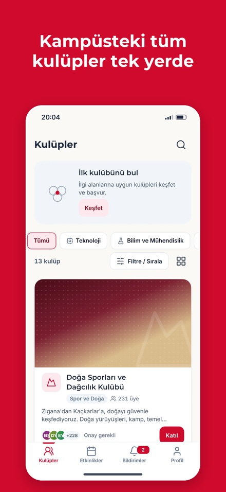
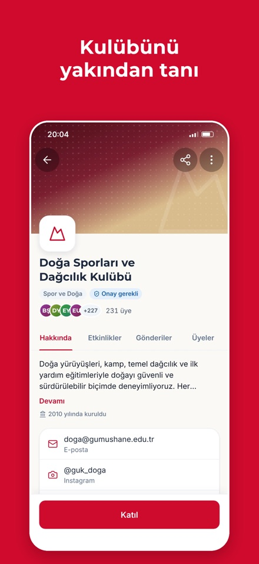
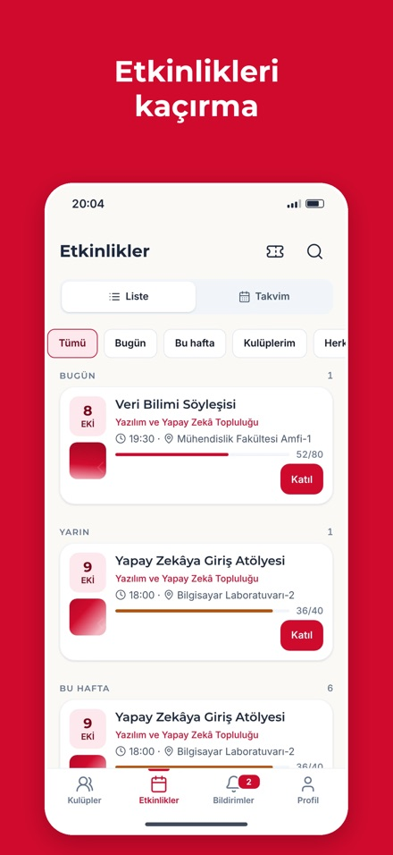
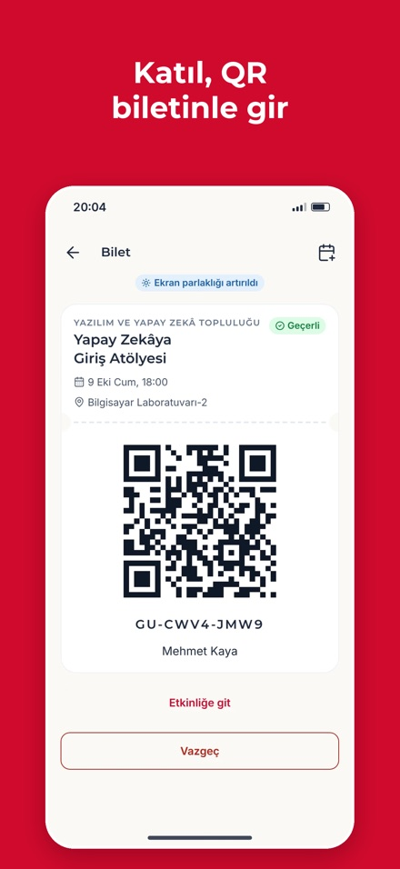
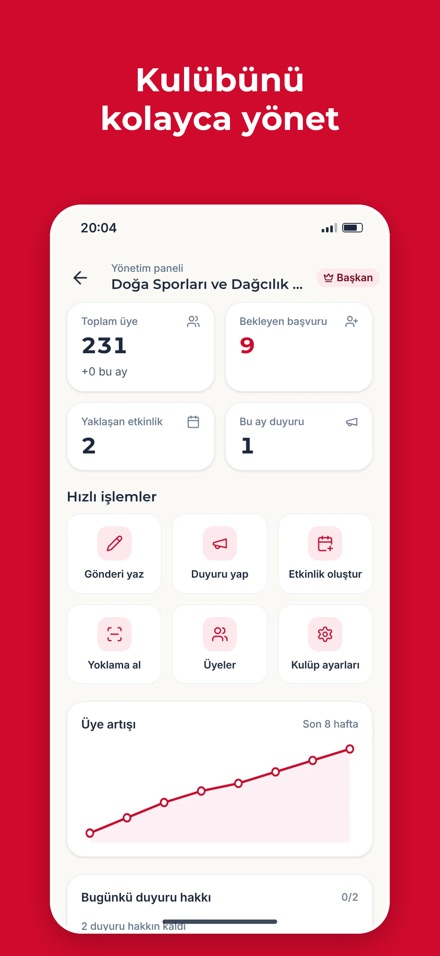

<div align="center">


# GÜ Kulüpler

**Gümüşhane Üniversitesi öğrenci kulüpleri için yönetim ve sosyal mobil uygulama.**
Kulüpleri keşfet, başvur, etkinliklere katıl, duyuruları kaçırma; kulübünü tek yerden yönet.

[](https://flutter.dev)
[](https://dart.dev)
[](https://firebase.google.com)
[](https://riverpod.dev)
[](LICENSE)
[](#-derleme-ve-dağıtım)

[Özellikler](#-özellikler) • [Teknolojiler](#️-teknoloji-yığını) • [Başlarken](#-başlarken) • [Mimari](#️-mimari) • [Test](#-test-ve-kalite-kapısı) • [Katkı](#-katkıda-bulunma)

### 📱 Uygulamayı dene

[-0D96F6?style=for-the-badge&logo=app-store&logoColor=white)](https://testflight.apple.com/join/YbsaqTNG)
[-3DDC84?style=for-the-badge&logo=android&logoColor=white)](https://github.com/muhammedeminalan/gu_kulupler/releases)
[](https://gu-kulupler.web.app/app/)

App Store sürümü incelemede · Google Play yakında · APK: [Releases](https://github.com/muhammedeminalan/gu_kulupler/releases)

</div>

<p align="center">
  
  
  
  
  
</p>

---

## 📖 Hakkında

**GÜ Kulüpler**, Gümüşhane Üniversitesi öğrenci kulüplerinin **resmî olmayan**, öğrenciler tarafından geliştirilmiş yönetim ve sosyal uygulamasıdır. Üniversite tarafından yürütülmez ve üniversiteyle bağlantılı değildir. Girişimcilik dersi projesi olarak başladı.

Öğrenciler kampüsteki kulüpleri keşfeder, birkaç dokunuşla başvurur, etkinliklere katılır ve QR biletle yoklamaya girer. Kulüp başkanları ve yönetim kurulu; başvuruları, üyeleri, etkinlikleri ve duyuruları uygulama içinden yönetir. Uygulama yöneticileri kulüpleri, şikayetleri ve kullanıcıları denetler.

### Öne çıkanlar

- 🏛️ **Kulüp rehberi:** kategori ve ilgi alanına göre listeleme, arama, kulüp önerileri
- 📝 **Üyelik başvurusu:** tek dokunuşla başvuru, durum takibi, yeniden başvuru bekleme süresi
- 🎟️ **Etkinlikler:** katılım bildirme, kontenjan ve otomatik ilerleyen bekleme listesi, QR bilet ve yoklama, takvime ekleme, hatırlatıcı
- 📣 **Akış:** duyurular, gönderiler ve anketler; beğeni, yorum, kaydetme
- 🔔 **Bildirimler:** uygulama içi bildirim kutusu ve push (başvuru sonucu, yeni etkinlik, iptal…)
- 🧑‍💼 **Kulüp yönetimi:** başvuru onay / ret, üye ve rol yönetimi, etkinlik oluşturma, içerik moderasyonu, etkinlik günlüğü
- 🛡️ **Uygulama yönetimi:** kulüp açma / askıya alma, şikayet inceleme, kullanıcı askıya alma
- 🔐 **Güvenli ve özel:** üniversite e-postasıyla kayıt, e-posta herkese gösterilmez, şikayet ve engelleme, uygulama içinden hesap silme
- 🌐 **Türkçe ve İngilizce**, açık ve koyu tema, çevrimdışı bant, bakım modu

---

## ✨ Özellikler

### Öğrenci

- **Keşfet:** tüm kulüpler, kategori süzgeci, sıralama, liste / ızgara görünümü, arama ve popüler aramalar
- **Kulüp sayfası:** hakkında, yönetim kurulu, danışman, gönderiler, etkinlikler, üyeler (üyelere açık)
- **Katıl:** başvuru notu (kulüp isterse), başvuru durumu, başvurudan vazgeçme, kulüpten ayrılma
- **Etkinlik:** katılım / vazgeçme, bekleme listesi, QR bilet, `.ics` ile takvime ekleme, hatırlatıcı süresi seçimi
- **Profil:** fotoğraf, bölüm, sınıf, ilgi alanları, biyografi; kulüplerim, kayıtlı gönderiler
- **Ayarlar:** dil, tema, bildirim tercihleri ve sessiz saatler, engellenenler, destek, hesap silme

### Kulüp yönetimi (başkan · yönetim kurulu · danışman)

- Başvuruları onaylama / reddetme (gerekçe + geri alma), üye çıkarma, rol atama, başkanlık devri
- Etkinlik oluşturma / düzenleme / iptal, katılımcı listesi, QR tarayıcıyla yoklama
- Duyuru (günlük sınırlı), gönderi ve anket paylaşma, içerik gizleme
- Kulüp profili: logo, kapak, açıklama, iletişim, katılım ayarları
- Etkinlik günlüğü: kulüpte kim, ne zaman, ne yaptı

### Uygulama yöneticisi

- Genel bakış metrikleri, kulüp açma / düzenleme / askıya alma
- Şikayet kuyruğu: içeriği kaldır, uyar, reddet
- Kullanıcı listesi: yöneticiler, askıya alınanlar, askıya alma / kaldırma

### Teknik

- Çevrimdışı önbellek (Firestore kalıcılığı) ve çevrimdışı bant
- Remote Config ile bakım modu ve zorunlu güncelleme kapısı
- Cloud Functions ile push dağıtımı, bekleme listesi terfisi, hesap silme temizliği
- **Soft delete:** hiçbir veri kalıcı silinmez (`isDeleted`, `deletedAt`, `deletedBy`)
- Yetki arayüzde değil **Firestore Security Rules**'ta uygulanır (rol × işlem matrisi testli)
- Erişilebilirlik: `Semantics` etiketleri, metin ölçeği 1.0 / 1.3 / 1.6, AA kontrast

---

## 🛠️ Teknoloji yığını

> Sürümler `pubspec.yaml` ile aynıdır. Bağımlılık güncellenirse bu bölüm de güncellenir.

| Alan | Kullanılan |
|---|---|
| Çatı | **Flutter 3.44.9**, **Dart 3.12.2** (`sdk: ^3.12.2`); pub workspace (`packages/gu_data`, `packages/gu_ui`) |
| State | **flutter_riverpod** ^3.4 + **riverpod_annotation** ^4.0 (`@riverpod` Notifier, kod üretimi); **equatable** ^2.1 — *Freezed ve `AsyncValue` kullanılmaz* |
| DI | **get_it** ^9.3 (`ProjectDependencyMixin`, `AppProviderMixin`) |
| Gezinme | **go_router** ^18 + **go_router_builder** (`@TypedGoRoute`, `StatefulShellRoute.indexedStack`) |
| Backend | **firebase_core**, **firebase_auth**, **cloud_firestore**, **firebase_storage**, **firebase_remote_config**, **firebase_crashlytics**, **firebase_messaging** |
| Sunucu | **Cloud Functions** (Node 22, `firebase-functions` 6, TypeScript) — `functions/` |
| Güvenlik | Firestore + Storage Security Rules (`firebase/`), emülatörde Jest ile rol × işlem testleri |
| Arayüz | Kendi tasarım sistemi `gu_ui` (token, tema, tipografi, çekirdek widget'lar — [katalog](docs/widget-catalog.md)); fontlar paketli (**Montserrat**, **Inter**); ikonlar **Lucide** SVG — *`google_fonts` ve Material `Icons` kullanılmaz* |
| Yerelleştirme | ARB + `gen-l10n` (TR varsayılan, EN); ICU çoğul / parametre; `intl` tarih ve sayı |
| Medya | **image_picker**, **flutter_image_compress**, **cached_network_image**, **flutter_svg** |
| QR | **qr_flutter** (bilet), **mobile_scanner** (yoklama) |
| Bildirim | **flutter_local_notifications** + **timezone** (hatırlatıcı), FCM (push) |
| Yardımcılar | **connectivity_plus**, **package_info_plus**, **url_launcher**, **share_plus**, **permission_handler**, **shared_preferences**, **path_provider** |
| Test | **flutter_test** (widget, golden, cihaz matrisi), **fake_cloud_firestore**, **firebase_auth_mocks**, **integration_test**, Jest (Rules, Functions), `node --test` (araçlar) |
| Kalite | **very_good_analysis**, `tool/quality_gate.sh` (biçim, analiz, katman sınırı, hardcode, hard delete, ARB, tasarım kapsamı, testler + kapsam eşiği, Rules) |

---

## 🏗️ Mimari

**Feature-first** düzen + paylaşılan `product/` katmanı + iki yerel paket. Ayrıntı: [`docs/architecture.md`](docs/architecture.md).

```
gu_kulupler/
├── packages/
│   ├── gu_data/        # modeller, enum'lar, FirebaseResult, servisler, repository'ler, soft delete
│   └── gu_ui/          # token, tema, tipografi, GuIcon, çekirdek widget'lar, overlay çerçeveleri
├── lib/
│   ├── core/           # bootstrap, DI, ortam (emülatör / üretim), hata ve günlük
│   ├── product/        # gezinme, geri bildirim katalogları (sheet / dialog / toast), ortak widget'lar
│   ├── features/       # auth, clubs, events, feed, notifications, profile, settings, management, admin…
│   │   └── <feature>/  # provider/ (ViewModel + State) · view/ (mixin/, widget/)
│   └── l10n/           # app_tr.arb, app_en.arb
├── firebase/           # firestore.rules, storage.rules, indeksler, Rules testleri
├── functions/          # Cloud Functions (TypeScript)
├── hosting/            # gu-kulupler.web.app (tanıtım, gizlilik, destek sayfaları)
├── tool/               # kalite kapısı, kod üretimi, tohum verisi, admin betikleri
├── test/ · integration_test/
└── docs/               # mimari, veri modeli, kurallar, gezinme, kararlar, planlar
```

**Katman kuralı (tek yön):** `view → viewmodel → repository (arayüz: gu_data) → service → Firebase SDK`

- `gu_ui` Firebase'e ve `gu_data`'ya bağımlı değildir (saf arayüz paketi).
- `gu_data` Flutter widget'ı içermez; ViewModel Firestore SDK tiplerini görmez.
- Feature'lar birbirini import etmez; ortak kod `product/` ya da paketlere çıkar.

### Tasarım kalıpları

- **MVVM:** her ekran ViewModel + State + View üçlüsüdür.
- **Riverpod Notifier:** state, elle yazılmış `copyWith` ve `props` içeren bir `Equatable` sınıftır. Yükleme ve hata `isFetching` / `isError` bayraklarıyla izlenir.
- **Sonuç tipi:** servisler istisna fırlatmaz, `FirebaseResult` (`FirebaseSuccess` / `FirebaseFailure`) döner.
- **Optimistik güncelleme:** beğeni, kaydetme, onay gibi işlemler önce arayüzü günceller; hata gelirse geri alır ve bildirim gösterir.
- **Tek geri bildirim kapısı:** bütün sheet, dialog ve toast'lar `FeedbackService` kataloğundan açılır.
- **Hardcode yok:** renk, boşluk, yazı tipi, süre ve metin token'lardan ve ARB'den gelir; `tool/check_hardcode.sh` reddeder.

### Özellik yapısı

```
features/clubs/
├── provider/
│   ├── club_list_view_model.dart   # @riverpod Notifier
│   └── club_list_state.dart        # Equatable state + copyWith
└── view/
    ├── club_list_view.dart         # ConsumerStatefulWidget, /// Design: CLB-01
    ├── mixin/                      # initState / dispose / etkileşim mantığı
    └── widget/                     # özelliğe ait widget'lar
```

Projenin bütün kuralları (isimlendirme, state, DI, gezinme, stil token'ları, test) [`CLAUDE.md`](CLAUDE.md) dosyasındadır. Belge haritası: [`docs/README.md`](docs/README.md).

---

## 🚀 Başlarken

### Önkoşullar

| Araç | Sürüm | Not |
|---|---|---|
| Flutter SDK | 3.44.9 | `flutter doctor` temiz olmalı |
| Node.js | 22 | Cloud Functions, Rules testleri ve `tool/` betikleri |
| Firebase CLI | güncel | `npm install -g firebase-tools` → `firebase login` |
| Java (JDK) | 17+ | Firebase emülatörleri için |
| Xcode + CocoaPods | güncel | iOS (yalnızca macOS) |
| Android SDK | compileSdk 37 | Android Studio ile |

### 1. Depoyu klonla

```bash
git clone https://github.com/muhammedeminalan/gu_kulupler.git
cd gu_kulupler
```

### 2. Bağımlılıklar ve kod üretimi

```bash
bash tool/codegen.sh
```

Bu komut `flutter pub get`, `build_runner` (kök + paketler) ve `gen-l10n` çalıştırır.

> **Dikkat:** üretilen dosyalar (`*.g.dart`, `lib/l10n/app_localizations*.dart`) depoya **commit edilmez**. Yeni klonlanan proje kod üretimi yapılmadan **derlenmez**.

### 3. Emülatörle çalıştır (önerilen)

```bash
bash tool/dev.sh
```

Komut sırasıyla şunları yapar:

1. Firebase emülatörlerini açar (Auth, Firestore, Storage, Functions).
2. Demo veriyi yükler: 14 kulüp, yüzlerce üye, gönderi ve etkinlik.
3. Uygulamayı `--dart-define=ENV=emulator` ile başlatır.

Gerçek Firebase projesine hiçbir istek gitmez. Demo hesaplar ve seçenekler [`tool/seed/README.md`](tool/seed/README.md) dosyasında.

```bash
bash tool/dev.sh -d "iPhone 16"   # belirli cihaz
bash tool/dev.sh --reseed         # açık emülatöre demo veriyi yeniden yükle
bash tool/dev.sh --stop           # emülatörü kapat
```

### 4. Kendi Firebase projenle çalıştır

Depodaki `firebase_options.dart`, `google-services.json` ve `GoogleService-Info.plist` dosyaları üretim projesi `gu-kulupler`'e aittir. Firebase istemci anahtarları gizli bilgi değildir; erişimi Security Rules sınırlar. Kendi projenle çalışmak için:

1. [Firebase Console](https://console.firebase.google.com/)'da proje aç. Şu servisleri etkinleştir:
   - **Authentication** (e-posta / şifre)
   - **Firestore**
   - **Storage**
   - **Remote Config**
   - **Crashlytics**
   - **Cloud Messaging**
   - **Cloud Functions** (Blaze planı gerekir)
2. Yapılandırmayı üret:
   ```bash
   dart pub global activate flutterfire_cli
   flutterfire configure
   ```
3. Kuralları, indeksleri ve fonksiyonları yükle:
   ```bash
   firebase deploy --only firestore:rules,firestore:indexes,storage,functions
   ```
4. Süper admin yetkisi ve diğer yönetim işleri için [`tool/admin/README.md`](tool/admin/README.md) dosyasına bak.

### 5. Kurulum kontrol listesi

- [ ] `flutter doctor` temiz
- [ ] `firebase login` yapıldı
- [ ] `bash tool/codegen.sh` hatasız bitti
- [ ] `bash tool/dev.sh` ile uygulama emülatörde açıldı
- [ ] `bash tool/quality_gate.sh --fast` geçti

---

## 🧪 Test ve kalite kapısı

```bash
bash tool/quality_gate.sh --fast     # ara kontrol: biçim, analiz, statik kurallar, hızlı testler
bash tool/quality_gate.sh --static   # yalnızca statik kontroller (~30 sn)
bash tool/quality_gate.sh            # tam kapı (~15–20 dk): tüm testler + kapsam eşikleri + Rules
```

Tam kapı şu adımları sırayla çalıştırır:

1. Biçim, ardından kod üretimi ve `gen-l10n`.
2. `flutter analyze --fatal-infos`.
3. Statik kurallar:
   - katman sınırı;
   - hardcode yasağı;
   - hard delete yasağı;
   - TR / EN ARB eşitliği;
   - tasarım kapsamı.
4. Testler ve kapsam eşikleri: `gu_data`, `gu_ui`, uygulama ve `tool/`.
5. Rules testleri (emülatör).

Kırmızı kapıyla commit yapılmaz.

| Test türü | Nerede | Komut |
|---|---|---|
| Widget, golden, cihaz matrisi (320 / 390 / 430 / tablet × açık / koyu × TR / EN × metin ölçeği) | `test/`, `packages/*/test/` | `flutter test` |
| Repository, servis, ViewModel | `packages/gu_data/test/`, `test/features/` | `flutter test` |
| Security Rules (rol × işlem; silme herkese kapalı) | `firebase/test/` | `cd firebase && npm ci && npm test` |
| Cloud Functions | `functions/test/` | `cd functions && npm ci && npm test` |
| Araç betikleri | `tool/test/` | `node --test tool/test/*.test.js` |

Golden'lar yalnızca bilinçli olarak güncellenir: `flutter test --update-goldens <dosya>`.

---

## 📝 Yapılandırma

- **Yerelleştirme:** metinler `lib/l10n/app_tr.arb` ve `app_en.arb` dosyalarındadır. Yeni metin önce iki ARB'ye eklenir, sonra kullanılır. Kod içinde `context.l10n.<anahtar>` ile erişilir. TR ve EN anahtar kümeleri eşit olmalıdır (`tool/check_arb_parity.js`).
- **Remote Config:** bakım modu, en düşük desteklenen build ve günlük duyuru sınırı buradan yönetilir. Şablon `firebase/remoteconfig.template.json` dosyasındadır, yükleme `firebase deploy --only remoteconfig` ile yapılır.
- **Tasarım token'ları:** renk, boşluk, radius, süre ve tipografi `packages/gu_ui/lib/src/tokens/` altındadır. Eşleme tablosu [`docs/token-map.md`](docs/token-map.md), widget kataloğu [`docs/widget-catalog.md`](docs/widget-catalog.md).
- **Uygulama ikonu ve açılış ekranı:** `flutter_launcher_icons` ve `flutter_native_splash` kullanılır, kaynak `assets/logo/`.
- **Ortam:** `--dart-define=ENV=emulator` emülatöre bağlanır, verilmezse üretim projesi kullanılır. Release derlemesi emülatörle açılmaz.

---

## 📦 Derleme ve dağıtım

```bash
flutter build apk --release        # Android APK
flutter build appbundle --release  # Google Play
flutter build ipa --release        # iOS (App Store / TestFlight)
flutter build web --release        # Web
```

- **Web (Hosting):** uygulama `gu-kulupler.web.app/app/` adresinde çalışır. `firebase deploy --only hosting` komutu önce `tool/build_web_hosting.sh` betiğini çalıştırır. Betik release web derlemesini `--base-href /app/` ile `hosting/public/app/` klasörüne koyar; bu klasör commit edilmez. Kökteki tanıtım, gizlilik ve destek sayfaları aynen kalır.

- **iOS:** bundle `com.gukulupler.guKulupler`, yalnızca iPhone, dikey yön. Mağaza metinleri `docs/store/app-store-metadata.json` dosyasındadır.
- **Web:** web derlemesinde push, yerel hatırlatıcı ve Crashlytics kapalıdır.
- **Firebase:** Rules, indeks, Functions, Hosting ve Remote Config `firebase deploy` ile yüklenir. Bu işlem yalnızca proje sahibinin onayıyla yapılır.

---

## 🔒 Güvenlik

Güvenlik açığını **herkese açık issue olarak bildirme**. Bildirim yolu ve kapsam için [SECURITY.md](SECURITY.md) dosyasına bak.

Temel ilkeler:
- Yetki Security Rules'ta uygulanır, arayüzde gizlemek yetki değildir.
- Silme işlemi bütün istemcilere kapalıdır.
- E-posta adresleri yalnızca yetkili kişilere görünür.
- Servis hesabı anahtarları depo dışında tutulur ve asla commit edilmez.

---

## 🤝 Katkıda bulunma

Katkılara açığız. Başlamadan önce şu dosyaları oku:
- [CONTRIBUTING.md](CONTRIBUTING.md): geliştirme akışı, dal ve commit biçimi, PR süreci, kod kuralları.
- [Davranış Kuralları](CODE_OF_CONDUCT.md): bu projeye katılan herkes bu kurallara uyar.

Hata bildirimi ve öneriler için [issue aç](https://github.com/muhammedeminalan/gu_kulupler/issues/new/choose).

---

## 📄 Lisans

Bu proje [MIT Lisansı](LICENSE) ile lisanslanmıştır.

**Üçüncü taraf varlıklar** kendi lisanslarıyla dağıtılır:
- **Montserrat** ve **Inter** fontları: SIL Open Font License 1.1.
- **Lucide** ikonları: ISC License.

"Gümüşhane Üniversitesi" adı yalnızca uygulamanın hangi kampüs için yapıldığını belirtmek için kullanılır. Bu proje üniversitenin resmî ürünü değildir.

## 📝 Değişiklik günlüğü

Sürüm geçmişi için [CHANGELOG.md](CHANGELOG.md) dosyasına bak.

## 👥 Katkıda bulunanlar

Katkıda bulunanlar ve teşekkürler için [CONTRIBUTORS.md](CONTRIBUTORS.md) dosyasına bak.

---

## 📞 Destek ve iletişim

- **Hata ve öneri:** [GitHub Issues](https://github.com/muhammedeminalan/gu_kulupler/issues)
- **Destek:** uygulama içinden *Profil → Ayarlar → Destek* ya da [gu-kulupler.web.app/destek](https://gu-kulupler.web.app/destek). Ayrıntılar [SUPPORT.md](SUPPORT.md) dosyasında.
- **E-posta:** eminalan334@gmail.com
- **Gizlilik politikası:** [gu-kulupler.web.app/gizlilik](https://gu-kulupler.web.app/gizlilik)
- **Geliştirici:** [@muhammedeminalan](https://github.com/muhammedeminalan)

---

<div align="center">

**Gümüşhane Üniversitesi öğrencileri için ❤️ ile yapıldı**

⭐ Faydalı bulduysan repoya yıldız ver!

</div>
